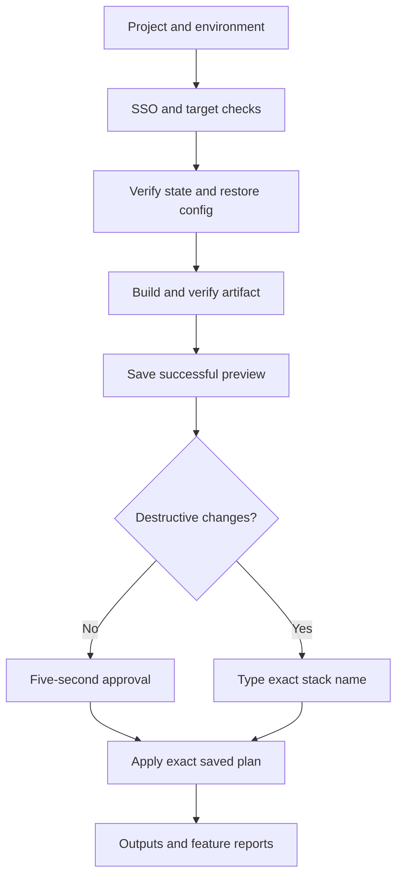
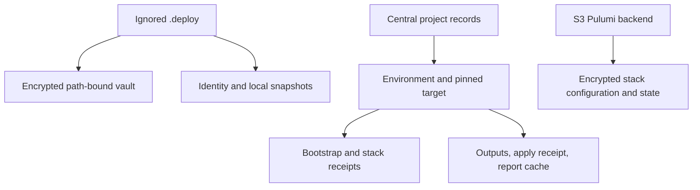

# Isolated OCR test bench (Development)

The root launchers use the shared [Infra Composer CLI](https://github.com/lambdawalker/go.infra.composer/tree/cfce9564fec239531a392b37078a8ccc350c28cd/deploycli), pinned in `tools/deploy/go.mod`. The benchmark's target, build package and output allowlist are in `deploy.json`. The launchers reuse existing `ocr-<environment>` stacks, S3 backends, scoped records and vaults.

This bench measures the existing production `BedrockExtractor` from the console. It deploys a private S3 bucket, an ARM64 Lambda, IAM role/policies and seven-day CloudWatch logs. No Android, Cognito, onboarding API, runtime-policy/reset tables, SQS, DNS or SES deployment is needed. This is the direct-extraction milestone; queued full-pipeline comparison remains future work.

The baseline uses the existing model `google.gemma-4-e2b`, medium reasoning, 4096-token ceiling, JPEG preprocessing and 55-second inference deadline. The Lambda has a 90-second timeout and configurable memory, default 1024 MB. Production defaults are unchanged. The optional synchronous extractor observer reports preparation and complete response-read durations only.

## Prerequisites

Install Go 1.27.3, AWS CLI v2 and Pulumi CLI v3, available on PATH. Configure an AWS IAM Identity Center profile. On first interactive setup, the script displays the STS account and signed-in identity and asks whether to proceed, defaulting to yes after five seconds. It then asks “Do you have an S3 bucket for deployment state?” with a five-second default of no. No (or timeout/Enter) automatically creates a uniquely named state bucket in the selected account/region, with versioning, AES256 encryption, all public-access blocks and a TLS-only policy. Yes asks only for the existing bucket name; the project state prefix is added automatically. Saved state locations are reused without asking again. Bucket bootstrap is an explicitly displayed part of first setup, including preview setup; it does not deploy the OCR stack. EOF, Escape and Ctrl+C cancel rather than acting as timer expiry.

Automatic state bootstrap additionally needs s3:CreateBucket, s3:PutBucketVersioning, s3:PutEncryptionConfiguration, s3:PutBucketPublicAccessBlock and s3:PutBucketPolicy. Bootstrap receipts are stored privately as state-bucket.json; partial configuration is resumed for the same bucket. The state bucket remains separate from the OCR input bucket and is never removed by benchmark teardown.

The deploying role needs the Pulumi AWS permissions to manage the listed S3, Lambda, IAM and CloudWatch resources, plus access to its state prefix and bucket validation APIs. The benchmark Lambda can only read `inputs/*` in its own bucket and invoke the configured model; it has no upload or state access. The console operator needs `s3:PutObject`, `s3:DeleteObject` on the bench inputs and `lambda:InvokeFunction` on the output function. Bedrock model availability/account authorization must already be enabled in the selected region.

## First setup and deployment

Run from any directory through the root launcher. Windows uses `deploy.bat` with the same flags.

```sh
./deploy.sh --action setup --environment dev --profile YOUR_SSO_PROFILE \
  --region us-east-2
./deploy.sh --action preview --environment dev
./deploy.sh --action deploy --environment dev
./deploy.sh --action status --environment dev
```

On the first interactive run, **project name is the first question**, defaulting to `card-capture-ocr-bench`. The repository remembers it in `.deploy/project.json`; later runs reuse it, the last environment and saved flags. Use `--project NAME` for the first CI run. A conflicting saved project or a name owned by another checkout fails rather than silently sharing deployment ownership. Build-only invocations need no project setup.

Nonsecret deployment records are centralized at `~/.infra-composer/<project>/environments/<environment>/`: settings, flags, state-bucket receipts, stack initialization receipts, operation locks and successful outputs. The repository's ignored `.deploy/` holds project identity, last environment, per-environment configuration/flag snapshots and encrypted vaults. Flags such as Lambda memory are reused unless explicitly overridden. Flags override saved settings; `--reconfigure` asks again for target settings. Do not commit or upload `.deploy`.

After authenticated S3 backend login, the wizard lists the project's remote Pulumi stacks. It selects an existing `ocr-<environment>` stack or initializes a genuinely absent stack automatically for setup/preview/deploy. `--init-stack` remains accepted for compatibility but is unnecessary. Listing/access failures never initialize a stack. If a receipt says a stack existed but it is now missing, recover state instead of silently recreating it. Status/destroy never create a stack. Initialization receipts are written only after successful init/select, and target-scope changes are rejected. Remote state remains authoritative.

The default project imports previous nonsecret settings from the former OS configuration directory when central settings are absent. Its existing vault is unlocked once and re-encrypted into `.deploy` with a fresh nonce/path binding, keeping the same Pulumi passphrase and preserving the source for recovery. Other project names start independently. A wrong passphrase/corrupt vault never overwrites either copy.

Account discovery, timed confirmation, SSO, saved account guards and state bucket validation work as before. CI requires explicit project/account/backend/environment inputs, uses OIDC, and never logs into SSO or implicitly bootstraps a state bucket. The reserved environment name `prod` is rejected.

The local vault uses versioned AES-256-GCM with PBKDF2-SHA256 (600,000 iterations), random salt/nonce and environment/path binding. Enter its unlock passphrase without echo and confirm on creation. Enter the existing Pulumi passphrase for an existing stack; never substitute a new one. Unlock is once per run. A corrupt vault/wrong passphrase fails without overwriting it. Back up both the central project records and repository .deploy directory and remember both passphrases. Moving a vault to a different path requires deliberate migration, not renaming. Alternatively provide `PULUMI_CONFIG_PASSPHRASE` through a protected process environment; this bypasses local persistence.

S3 encryption, Pulumi configuration-secret encryption and the local vault protect different things. Pulumi state can contain sensitive values; restrict state access with IAM. Encrypted authoritative stack configuration is refreshed from the backend before local nonsecret updates. No keys or application secrets are generated by this stack.

Build happens before preview/apply. Artifact cache keys include canonical source/module content (including uncommitted edits), toolchain and packaging recipe; ZIP hashes are verified before reuse. Use `--force-rebuild` to bypass it, or use `--action clean-cache` (fails while a build/preview/apply owns the artifact lock). Pulumi still previews remote changes; a local cache never skips infrastructure reconciliation.

Deploy first produces a saved plan. Interactive apply shows the exact target and a five-second default-to-proceed countdown; Enter/yes proceeds, no/Escape/Ctrl+C cancels. Closed input/EOF cancels. The account and S3 questions use the same timer/input handling. Plans containing delete/replacement operations require typing the exact stack name with **no timeout**. No destructive action defaults to yes. CI requires `--non-interactive --approve` and rejects destructive plans. Preview/setup/status/build never become apply.

## Run photos from the console

The usual command is now:

```sh
go run ./cmd/ocr-bench
```

It loads the project/last environment from `.deploy`, profile/region/account from saved deployment settings, and bucket/function from the successful deployment outputs in the central project records. Explicit flags override saved values. It finds a unique front.jpg/front.jpeg/front.png and back equivalent in the repository or photos directory; otherwise it asks for the missing paths and remembers them. PNG/JPEG inputs are converted to temporary JPEGs automatically. Required missing values are prompted individually; EOF fails clearly rather than guessing. Authentication/account verification happens before uploads. Cleanup targets only successfully uploaded objects.

Use `--environment qa` to select a different saved deployment. The default report is `ocr-bench-report/index.html`. Open it in a browser to see latency charts and expand the run details for each fixture. Use `--report ocr-bench-report.json` for machine-readable output. The full command below remains available for explicit overrides.

Copy the `bucket` and `function` outputs from status:

```sh
go run ./cmd/ocr-bench --profile YOUR_SSO_PROFILE --region us-east-2 \
  --bucket BENCH_BUCKET --function BENCH_FUNCTION \
  --front /path/to/front.jpg --back /path/to/back.jpg \
  --runs 20 --report ocr-bench-report/index.html
```

Use quoted paths on Windows. Each execution uploads once under a random prefix and invokes serially through IAM. Inputs are deleted on exit; a one-day lifecycle is fallback cleanup (not an exact deletion deadline). The bucket has deletion protection and is not force-destroyed. No public function URL exists.

Reports contain per-attempt success/failure, S3-read, preparation, complete inference-response, extraction, server-total and client-observed milliseconds. Upload is measured separately. Client time includes invocation/network/init overhead. `cold_start` marks the first request handled by that execution environment, not a promise of a forced cold start. Warm percentiles exclude those first requests. Percentiles use nearest rank over successful runs; failures are reported and produce a nonzero exit status. No automatic retry hides failed samples. More repetitions are needed for meaningful tail estimates; start sequentially before testing concurrency.

Ordinary timing-only invocations omit extracted fields. Validation runs may explicitly request extracted fields for the local HTML comparison. Keep those reports private and use synthetic inputs.

## CardDetector Android demo

The Android **Backend OCR** demo connects directly to the hosted demo API.
Deploy the [demo stack](../infrastructure/demo-invitations/README.md) with the
existing isolated bench bucket and Lambda ARN, invite a tester, and sign in
from the app. Confirmed front/back captures become one color JPEG, bounded to
1200 × 1200 and 500 KiB. The app uploads directly to S3 and polls its own job
for OCR timing and extracted fields. Use synthetic cards only.

The workstation bridge and `--android-bridge` flag have been removed. The CLI
continues to support its image-pair and dataset benchmarks. Demo authentication,
job storage and HTTP routes are provisioned only by the separate demo stack.

Compare memory configurations by previewing/deploying `--memory 2048`, then rerunning the same photos and repetitions. Keep region/model/photos constant. Do not attribute internet/upload time to model inference.

## GitHub Actions and OIDC

The manual workflow is `.github/workflows/ocr-bench-deploy.yml`. It uses the same Go deployer with explicit noninteractive inputs, no countdown, and one concurrency group per target. It never runs merely because code is pushed.

The wizard offers optional GitHub setup during setup/deploy; skipping is remembered and local deployment remains available. Use `--action github-setup` to configure or reconcile it later. Setup does not dispatch a workflow or apply the OCR stack. It requires an existing verified S3 backend; this action never bootstraps a new bucket.

```sh
./deploy.sh --action github-setup --environment dev \
  --github-repository lambdawalker/go.appexfission.aws.card-capture \
  --github-environment ocr-bench-dev \
  --github-policy /private/reviewed-bench-policy.json
```

The signed-in GitHub identity and repository are checked before writes. The reviewed setup plan is saved to the selected central environment's `github-setup-plan.json`. It shows environment/reviewer/default-branch mapping, provider/role creation, exact OIDC trust, managed policy and variables. Type the GitHub environment name to authorize changed setup; there is no timeout. An unchanged verified rerun needs no setup approval. Use `--skip-github` to skip optional integration reconciliation for a local run. New environments require the signed-in user as reviewer and restrict deployment to the repository default branch. Existing protections/reviewers/restrictions and unrelated variables/secrets remain intact. Existing environments without reviewers/restrictions stop for manual review rather than being weakened or silently adopted.

By default the deployment role is `<project>-<environment>-deploy`; `--github-role ARN` selects an existing compatible role in the discovered account. The wizard reuses a compatible provider, or creates the GitHub OIDC provider and role when absent. Trust must require audience `sts.amazonaws.com` and the exact subject `repo:lambdawalker/go.appexfission.aws.card-capture:environment:<github-environment>`. Incompatible existing trust stops without replacing independent statements. Only the `CardCaptureDeployment` inline policy is reconciled; other policies are untouched.

**Policy limitation:** creating a role requires a reviewed JSON policy file. This tool cannot infer safe permissions for arbitrary existing physical resource identities or operator-owned buckets. Enumerate the needed S3 state-prefix/bucket validation operations, benchmark S3/Lambda/CloudWatch operations, and IAM role/policy/PassRole operations for the actual benchmark resources. Restrict account, region, resource ARNs and applicable request/resource tags; restrict PassRole to the Lambda service. Avoid wildcard actions. The validator rejects service/action wildcards and unconditional wildcard resources, but is not an IAM policy analyzer or proof of least privilege. Existing compatible roles reuse the previously reviewed managed inline policy. No long-lived AWS keys or SSO cache tokens are transferred.

Managed variables: `BENCH_PROJECT`, `BENCH_ACCOUNT`, `BENCH_REGION`, `BENCH_BACKEND`, `BENCH_ENVIRONMENT`, `BENCH_ROLE_ARN`, and `DEPLOY_CONFIG_SHA256`. Secret: `PULUMI_CONFIG_PASSPHRASE`, delivered from unlocked memory via CLI stdin. Stored secret values cannot be read back. Scoped delivery receipts and a nonsecret rotation identifier support unchanged reruns; use `--github-secret-version 2` for deliberate replacement or `--force-reconcile` to re-deliver. Readable fields, secret names, protections and IAM references are checked even when a fingerprint matches. Completion marker is written last. Partial attempts remain resumable and never claim completion.

If permissions or GitHub plan limitations block setup, the command reports **INCOMPLETE** and prints the exact environment, role and variable values for recovery. With an account/repository administrator:

1. Open the environment settings link below and create/select the printed environment. Add the printed reviewer and default branch restriction, preserving all existing reviewers/protections. If GitHub cannot protect this repository's environments under the current plan, setup remains incomplete.
2. In IAM, select/create provider `https://token.actions.githubusercontent.com`, audience `sts.amazonaws.com`. Create/select the printed role and apply the reviewed plan's trust document. Do not broaden the subject or audience. Attach the reviewed plan's policy as inline policy `CardCaptureDeployment`; preserve unrelated policies.
3. Set each printed `BENCH_*` variable in that environment. Deliver the **existing** passphrase with `gh secret set PULUMI_CONFIG_PASSPHRASE --repo lambdawalker/go.appexfission.aws.card-capture --env <printed-environment>` and enter it privately at the prompt. Do not put its value in shell arguments.
4. Rerun the exact setup command to read back accessible managed fields and finish receipts/marker. Do not manually claim successful setup by setting only the fingerprint.

The workflow has a separate `approve` checkbox (default false) for deploy. Preview/status never receive apply approval; deploy requires `approve=true`, environment approval, a successful saved plan and no destructive operations. Concurrency conservatively serializes the same stack environment, even through different GitHub environment aliases. No workflow was dispatched to validate this tooling.

Workflow: https://github.com/lambdawalker/go.appexfission.aws.card-capture/actions/workflows/ocr-bench-deploy.yml
Environments: https://github.com/lambdawalker/go.appexfission.aws.card-capture/settings/environments

## Recovery and teardown

Re-run the same environment/action after interruption; Pulumi reconciles partial resources. Local `operation.lock` blocks simultaneous local operations. On a stale lock, first verify the process is gone, then remove that local file manually. Never remove Pulumi backend locks automatically; inspect active operations before using Pulumi's documented cancellation recovery. Private outputs are written only after successful apply/output retrieval. No receipt claims remote health from a local hash.

Status reads stack outputs. For live acceptance, upload a known pair, confirm successful samples, inspect stage timings/failure counts and confirm cleanup. This operation incurs real inference charges and is operator initiated, not part of automated tests.

To retire the stack: explicitly delete any remaining inputs and remove the bucket's Pulumi protection after reviewing the exact target. `--action destroy` then displays the target stack and requires typing that exact name, with no default and no timeout. It does not delete the shared state bucket, remove state, automatically empty evidence, or steal locks. Preserve the backend/vault backup until recovery is no longer needed.

## Offline verification

```sh
go test -race ./...
go vet ./...
go -C infrastructure test -race ./...
go -C infrastructure vet ./...
./scripts/build.sh
./deploy.sh --action build
```

No live deployment or workflow dispatch is required for these checks.

### Console presentation

The wizard groups account details, state, build, preview and apply into labeled steps. On terminals, the countdown updates one line in place and clears it on completion/cancellation. Redirected logs print a single default/timeout message instead of progress frames. Color is optional, respects NO_COLOR and TERM=dumb, and falls back to plain text on older Windows consoles; the in-place countdown uses carriage returns rather than ANSI cursor commands.

Project records and `.deploy` are local operator data, not a replacement for Pulumi state backups. Removing either is not permission to recreate missing infrastructure. For a moved checkout, deliberately review/update the central project root binding; do not rename encrypted vaults because they are bound to their paths.

### Default launcher action

A plain interactive `deploy.bat` or `./deploy.sh` invocation defaults to **deploy**: it builds, previews, then offers the five-second apply confirmation. Use `--action preview` to stop after planning. Noninteractive runs without an action continue to default to preview; applying in CI still requires explicit `--action deploy --approve`. Explicit status/build/setup/preview actions never escalate to apply.

Plan inspection checks only resource operation steps, not property names such as `deleteBeforeReplace`. Eligible nonsecret defaults and non-destructive deployment approval use the in-place five-second countdown; EOF/Escape/Ctrl+C/input errors cancel. Text input pauses the default countdown once editing begins and requires Enter to submit. Destructive approval has no timer. Teardown still requires explicitly choosing `--action destroy`; the ordinary deploy path never selects it. Secret entry still requires actual user input.

### AWS console ownership metadata

The input bucket, Lambda, IAM role and log group carry Name (`<project>-<environment>`), Project, Environment, Component, ManagedBy and Description tags. Lambda and IAM roles additionally expose native descriptions. Deployment project/environment are passed from the wizard to Pulumi; direct Pulumi runs fall back to its project and stack environment. Stack outputs expose deploymentIdentity and resourceMetadata, including ownership/purpose of untaggable S3 configuration and IAM policy attachments. Existing physical resource names remain stable while metadata is updated.

State buckets created by this wizard receive the same project/environment identity and a deployment-state component. Existing unrelated tags are preserved and unchanged metadata skips writes. Shared operator-supplied state buckets are not claimed; a matching bootstrap receipt is required, including scope-checked legacy receipt migration. State tagging requires s3:GetBucketTagging and s3:PutBucketTagging. Status/destroy remain read-only with respect to state bucket metadata.

### Feature-scoped deployed artifact reports

The standalone bench produces JSON, Markdown and self-contained HTML reports using the same Infra Composer reporting model/Pulumi adapters as Attestra. This is a **feature** report, not an application aggregate: all managed resources in the dedicated benchmark stack belong to the card-capture repository/feature. The normal host-integrated feature still supplies its own inventory to the application; it does not own the host's identity, API or shared configuration.

Preview and deployment attempts save reports under `.deploy/reports/<environment>/<timestamp>/artifacts.{json,md,html}` and print the HTML path. Deployment attempts are reported even after failure; read-only verification preserves partial observations. Scoped normalized caches live under `~/.infra-composer/<project>/environments/<environment>/reports/`. Cached observations retain original timestamps.

Generate a report for the selected existing stack:

```sh
./deploy.sh --action report --environment dev
./deploy.sh --action report --environment dev --refresh-report
```

Windows uses `deploy.bat` with the same arguments. Report-only exports the selected stack inventory as recorded evidence. `--refresh-report` additionally runs `pulumi refresh --preview-only`, never an apply. Deployment attempts also verify using that read-only path. State reads alone never mean live presence; exact refresh completions establish present/absent, while inaccessible/unsupported resources remain unknown. Warnings and incomplete/failed outcomes are preserved.

The HTML explorer supports hierarchy, search, filters and artifact details. JSON/Markdown describe the same snapshot. Reports include revision, scope, owner, physical/logical identities, planned actions and evidence/configuration timestamps. Only the reporting library's safe output-settings allowlist is copied. Raw exports, event logs, policies, environment variables, image contents and provider diagnostics are not persisted. Private temporary preview/refresh logs are removed.

Wizard-owned bootstrap state buckets are included only with matching account/region/identity receipts and a scoped head-bucket check. Operator-supplied shared state buckets are external dependencies and are not claimed. No application dashboard, DNS/GitHub inventory expansion or cross-feature aggregation is added to this library.

Taggable benchmark resources additionally expose standard `ic:owner`, `ic:feature` and `ic:managed-by` tags for compatibility with host reporting. Untaggable child ownership is assigned only within this dedicated feature stack. The existing `preview.sh` offline full-feature catalog remains separate: its illustrative/mock inventory never proves deployment.

### Per-session local/cloud diagnostic bundles

Each benchmark execution prints a timestamped folder under `.deploy/ocr-bench/runs/<timestamp>/`. Keep the whole folder when requesting debugging help:

- `manifest.json`, `summary.json`: session identity, requested repetitions and final benchmark results.
- `local/setup.json`, `local/completion.json`: selected deployment settings and the local stage/outcome (including setup failures before invocation).
- `attempt-NNN/local/invoke.json`: client timing, CLI exit status, invocation HTTP status and safe diagnostic.
- `attempt-NNN/cloud/result.json`: the Lambda's benchmark timings/result.
- `attempt-NNN/cloud/logs.json`: sanitized CloudWatch evidence, source, request ID, collection status and omitted-message count.

CloudWatch collection uses the same AWS profile and requires `logs:FilterLogEvents` and `logs:GetLogEvents` on the benchmark log group. For known request IDs, it retries discovery briefly, then reads a bounded stream window and keeps only that request's START-through-REPORT events. Missing request IDs use a bounded time-window lookup explicitly labeled uncorrelated. Missing permissions, delayed logs, partial windows and collection failures are separate from OCR success/failure; the invocation log tail is retained as a sanitized fallback. Collection time is excluded from measured invocation latency.

Bundles allowlist timing/status fields and known runtime error codes; unknown messages are counted and omitted. They never contain image files, credentials, raw provider diagnostics, complete raw log tails or extracted identity fields. Zip the printed session folder to share it. Original test photos can be supplied separately if needed; review deployment identifiers in the bundle before sharing publicly.

### Compact stitched input

The console runner now reduces each side to fit 1200 × 600 pixels without
upscaling, preserves its aspect ratio, and stacks front above back on white, and converts to grayscale (shades of gray, not a binary threshold).
The resulting JPEG has no edge over 1200 pixels and is limited to 500 KiB.
It first tries JPEG quality 85, 75, then 65; unusually noisy inputs are reduced
further, or rejected with a request for tighter crops if the size cap cannot
be met. Source files are never overwritten. Temporary image files are deleted
when the runner exits and are excluded from diagnostic bundles.

Only one S3 PUT, one Lambda S3 read, and one model image are used per session.
The model prompt identifies the front at the top and back at the bottom.
The production two-image extraction API is unchanged; the benchmark Lambda
also accepts legacy front/back requests for compatibility.

**Redeploy the benchmark Lambda before using the updated runner:**

```powershell
.\deploy.bat
go run ./cmd/ocr-bench --runs 20
```

Reports add `image_prepare_ms`, `upload_bytes`, `upload_width_px`,
`upload_height_px`, `input_color_mode: "grayscale"`, and
`input_layout: "front_above_back"`. Local preparation is outside `upload_ms`
and `client_ms`; add all three for initial end-to-end latency. Upload happens
once per session, not once per inference attempt. Compare against earlier
reports using the same images: fewer bytes and one image can improve speed,
but reduction can affect small-text accuracy, and model latency is variable.

The width and height fields describe the actual uploaded JPEG after any size
fallback, not the 1200 × 1200 maximum. Smaller photos are not upscaled.
These console preparation/report changes require pulling the updated runner;
the existing stitched-input Lambda remains compatible.

The benchmark and the live capture worker request `reasoning_effort: "medium"`.
Deploy the corresponding backend before measuring this change. Keep images and run count constant when comparing against prior
reports, and check failures/JSON validity as well as latency.

### Validate exported fixtures

Run `go run ./cmd/ocr-bench` from the repository root to validate the
`./validation` directory, or pass `--directory PATH` to use a different export.
Each immediate numbered subdirectory (such as `0001`) must contain
`layout-1.jpg` (front), `layout-2.jpg` (back), and
`expected-card-capture.json` with every OCR field as a string, including
`issued_identifier`. Empty strings assert that a field is absent.

Redeploy the benchmark Lambda before using directory validation. Each fixture
runs once by default. Use `--runs N` to repeat each fixture. The Lambda compares
the extracted values to the expected JSON and returns the similarity score and mismatch field names.
Validation passes at 90% similarity by default. Set a different cutoff with
`--min-similarity N` (use 100 for an exact match after address whitespace
normalization). Each field counts equally. The score uses character edit
distance, with fields empty on both sides excluded. Mismatch field names
remain visible even when the fixture passes. The report
contains fixture results and the command exits nonzero if any validation fails.
Explicit `--front` and `--back` still select the timing-only mode.

In an HTML validation report, the selected test shows expected and extracted
JSON side by side below the timing table, with the uploaded image on the right. Highlighted lines show exact
text differences, including formatting differences that similarity scoring
may ignore. The report folder contains document values and the exact uploaded JPEGs in
`resources/`. Keep the folder together when moving the report. The JSON report and
diagnostic summaries contain scores and mismatch names. Redeploy the benchmark
Lambda to enable the comparison view.

For account provisioning for the standalone demo, see the [CardDetector demo invitation console](../infrastructure/demo-invitations/README.md).

## Deployment flow and recovery boundaries



Explicit setup/build/status/preview actions exit at their own boundary. State bootstrap is separate from stack apply; setup/preview can initialize genuinely absent state after successful discovery. GitHub setup only configures the requested integration after typed review. Read-only report refresh is separate from resource mutation.



Central settings are authoritative; local snapshots support workstation consumers. Flags override nonsecret settings only within the pinned scope. Account/region/backend changes require a distinct scope or a reviewed migration, not `--reconfigure` acceptance. A moved checkout is rejected until its project binding and path-bound vault are recovered deliberately.

Export/import only nonsecret portable answers:

```sh
./deploy.sh --environment dev --export-settings /private/dev-settings.json
./deploy.sh --action setup --project card-capture-ocr-bench --environment dev \
  --import-settings /private/dev-settings.json
```

Import requires the same project/environment and compatible target. It does not transfer stack ownership, successful completion, GitHub delivery receipts or secrets. The older OS-config-directory layout is recognized only for the original default project; its vault is decrypted and re-encrypted with the new path binding, retaining the old file. Back up central records, `.deploy`, S3 version history and both passphrases separately. Do not copy/rename a vault to bypass its scope. General arbitrary vault relocation and automatic rotation are not implemented; recover at the original path before migrating. Never delete local records as a way to authorize replacement infrastructure.

After interruption, rerun the same action/environment, for example `./deploy.sh --action deploy --environment dev`. A pending bootstrap receipt probes its exact bucket; access failures stop without replacement. Lost initialized stacks stop for state recovery. If all local receipts and remote state are lost, stop and restore backups: remote absence alone cannot prove that old AWS resources do not exist. For stale `workspace.lock`, `operation.lock`, `project.lock` or `build.lock`, verify no process is active before manually removing that exact local lock; never automatically remove Pulumi locks.

`--workers 2` bounds independent prerequisite checks (1..8). The benchmark has one compiled target. Cache fingerprints include actual Go dependency/replacement content, embedded assets, module metadata, toolchain/build environment and packaging recipe. Input changes during compilation fail without a completion marker. A build lock protects artifact publication and remains held through preview/apply. Inputs and archive bytes are distinct hashes; a successful apply receipt is distinct again. `status` exports only bucket/function/model/deployment identity and is not a health assertion. Use report refresh for read-only presence evidence; the explicit synthetic-image acceptance procedure above exercises inference and incurs charges.

See the [requirement matrix](deployment-alignment.md) for implementation status and remaining limitations. Windows cross-compilation and static batch inspection are not native console testing. The normal CI Windows job exercises the batch launcher; an operator should additionally test typed defaults, Escape/Ctrl+C, secret input, terminal restoration and private-directory ACLs in the intended Windows/IDE terminal. Early authentication/state-selection failures do not have an inventory report; they fail with an actionable error before a trustworthy scope can be established.

Existing remote stack identity is checked **before** writing new identity settings. If an older stack has managed resources but lacks `deploymentIdentity`, inspect the original project/backend and state ownership, then use `--adopt-legacy-stack` interactively and type its exact stack name. This adds metadata through the normal preview; it does not rename or replace resources. A known identity mismatch cannot be overridden by this flag. CI cannot adopt legacy identity metadata.
